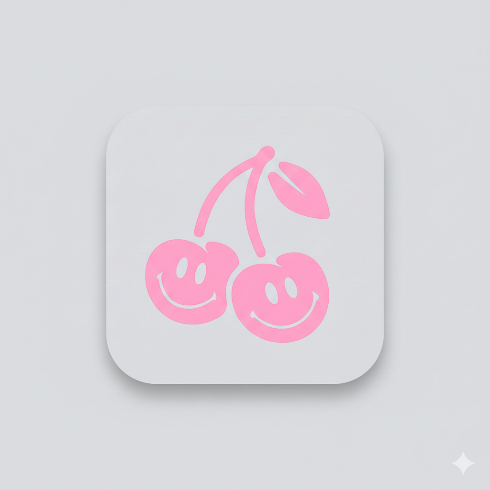
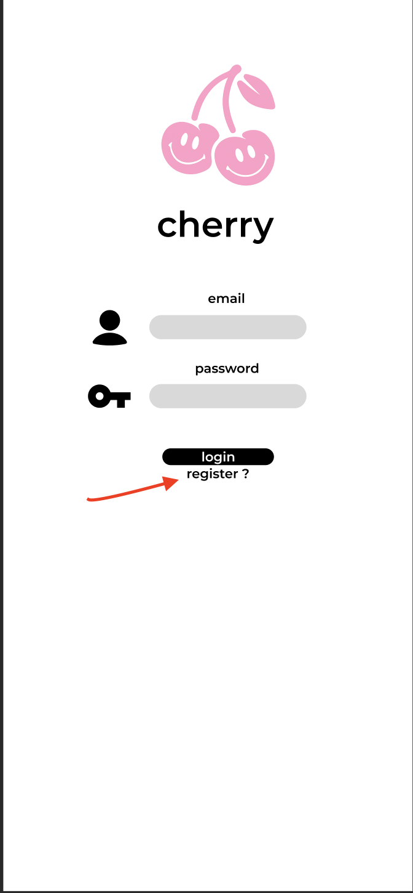
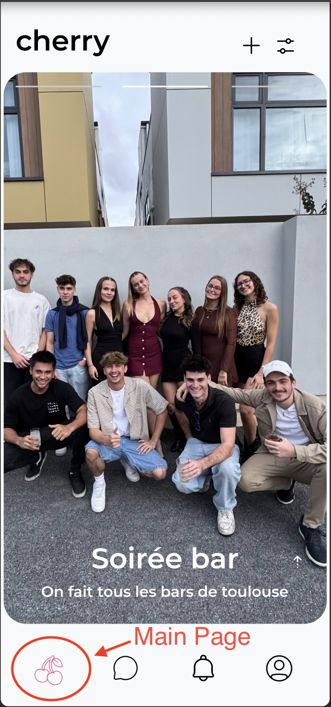
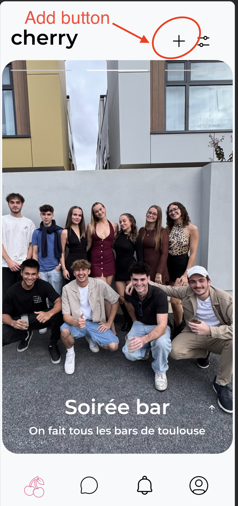
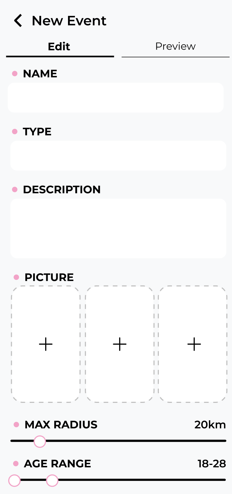
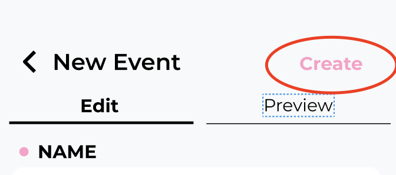
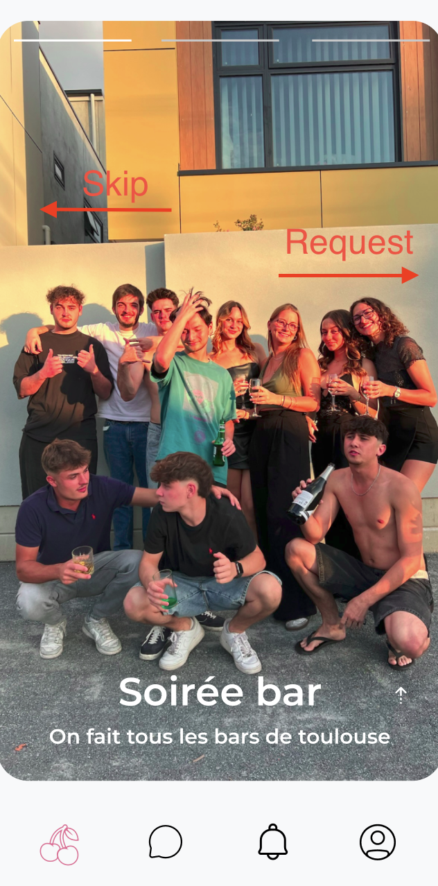
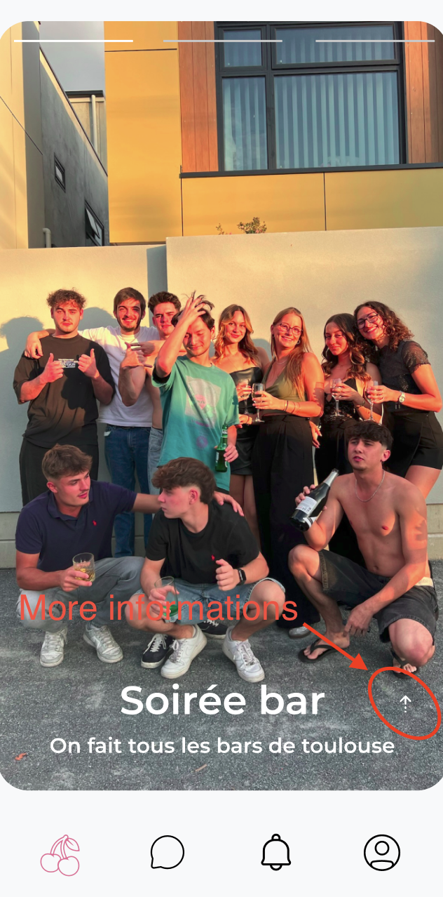
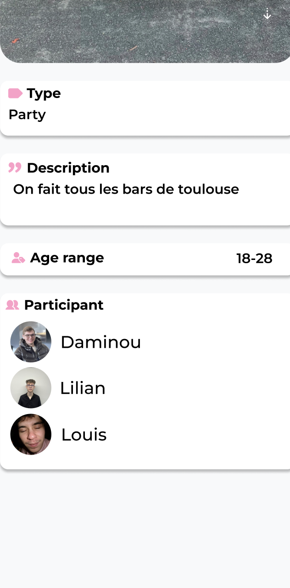

# User Journey

## Getting Started

Let’s begin by opening the application.

  

---

## Authentication

When the app launches, you are redirected to the authentication page.

- If you **already have an account**, simply log in.
- If you **don’t have an account**, click on **Register**, as shown below.

  

---

## Registration Process

To create an account, you need to provide the following information:
- First name
- Last name
- Email address
- Phone number
- Date of birth
- Password

After submitting the form, you must **verify your phone number**.  
A verification code will be sent via SMS and must be entered to proceed.

---

## Profile Setup

Once your phone number is verified, you can complete your profile by:
- Uploading one profile picture
- Uploading up to 6 pictures to present your self
- Adding your hobbies and interests
- Accept to us to be able to access to your localisation
- A small description about you (About me)
- Option to add a social status

This step personalizes your experience and helps other users get to know you better. Once you have done that your account is created 😁 !

## Create an Event

Creating an event allows you to invite nearby users and organize activities easily.  
Follow the steps below to create your own event directly from the application.

---

## Step 1 → Access the Main Page

To start creating an event, go to the **main page** of the application.  
From there, click on the **small cherry icon** located at the **bottom-left corner** of your screen.  
This button gives you access to the main features of the app, including event creation.

  

---

## Step 2 → Open the Event Creation Page

Once you are on the main page, look at the **top-right corner** of the screen.  
Click on the **“+” button** to be redirected to the **Add Event** page.

This action allows you to start setting up a new event and define its main characteristics.

  

---

## Step 3 → Fill in the Event Information

On the event creation page, you will be asked to provide all the necessary details about your event.  
Make sure the information is clear and accurate to attract the right participants.

You can configure the following elements:

- **Event name**: Choose a clear and attractive title  
- **Event type**: Select the category that best fits your event  
- **Description**: Explain what the event is about and what participants can expect  
- **Pictures**: Upload up to **3 images** (recommended) to showcase your event  
- **Maximum distance radius**: Define how far users can be to see your event  
- **Age range**: Set the minimum and maximum age allowed to participate  

  

---

## Final Step → Create the Event

Once all the information has been filled in, review your event details carefully.  
When everything is ready, simply click on the **“Create”** button to publish your event.

Your event will then become visible to eligible users within the selected radius.

  

## Look for an Event

Browsing and discovering events is simple and intuitive.  
From the main page, you can explore available events and quickly decide whether you want to participate or skip them.

---

## Step 1 → Access the Main Page

As with other features, start by navigating to the **main page** of the application.  
This is where all nearby and relevant events are displayed based on your preferences, location, and age range.

Each event appears as a card with a preview images, allowing you to get a quick overview.

---

## Step 2 → Browse Events Using Swipe Gestures

You can interact with events using swipe gestures:

- **Swipe right** 👉 to **request participation** in an event  
- **Swipe left** 👈 to **skip** the event and move on to the next one  

This gesture-based navigation makes browsing fast and enjoyable, allowing you to explore many events in just a few seconds.

  

---

## Step 3 → View Event Pictures

If an event includes multiple pictures, you can view them easily:

- **Tap on the event card** to scroll through all available images  

This helps you better understand the atmosphere, location, or activity related to the event before making a decision.

---

## Step 4 → Access Detailed Event Information

To see more detailed information about an event, click on the **small arrow icon** located at the **bottom-right corner** of the event image.

  

This will open a detailed view where you can find:

- **Event description**: a full explanation of the event  
- **Event type**: the category it belongs to  
- **Age range**: minimum and maximum age required  
- **Participants**: a list or count of users already participating  

This detailed view helps you decide whether the event matches your interests and expectations.

  

---
